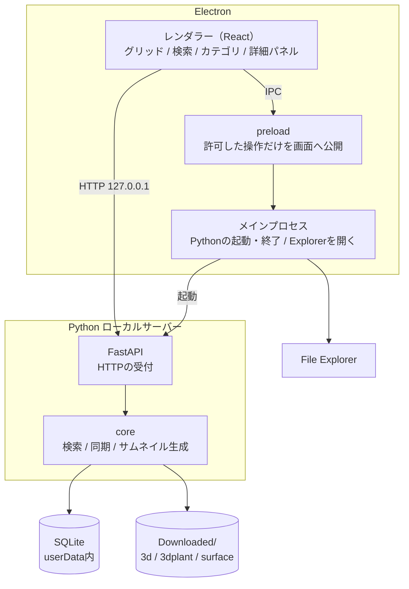
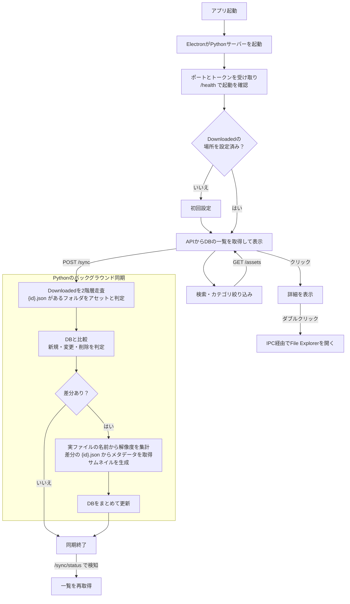
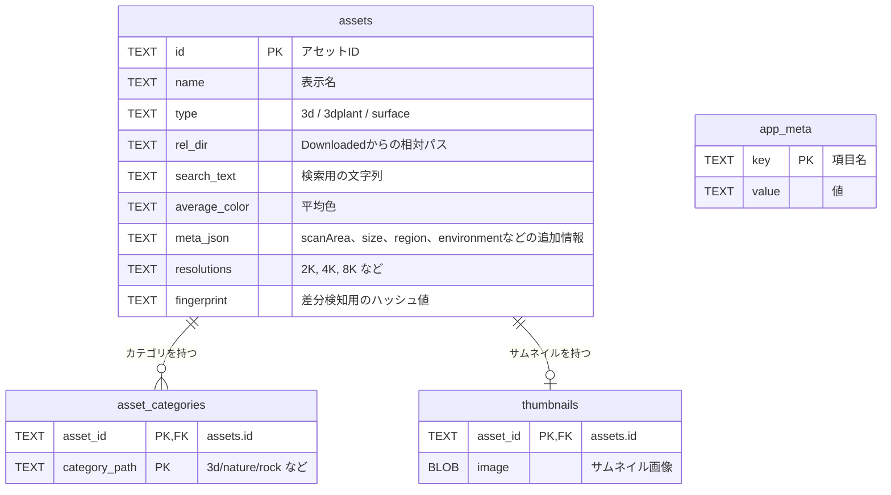

# デスクトップ版 Megascans Browser 設計

- 状態：設計確定、実装前（2026-11-03時点）
- 検証データ：`assetsData.json`（37アセット）、`{id}.json` 3件（surface / 3d / 3dplant 各1件）
- 実機確認：Downloaded直下は `3d`、`3dplant`、`atlas`、`brush`、`DHI`、`surface`、`assetsData.json`

## 決定事項

- アプリはElectron + Pythonで作る。画面はElectron、検索・同期・サムネイル生成はPythonが担当する
- ダウンロード済みのアセットだけを一覧に出す
- 検索はDBだけで行い、毎回JSONを読まない
- 正のデータはDownloadedフォルダと各アセットの `{id}.json`
- 対象はBridgeでダウンロードしたアセットのみ
- 対象タイプは `3d`、`3dplant`、`surface`。`atlas`、`brush`、`DHI` は除外する
- `{id}.json` の構造は確認した3タイプの形式だけを前提にする
- `assetsData.json` は使わない。ファイル情報がほとんどなく、どのみち `{id}.json` が必要になるため
- ポリゴン数、色空間、バリエーション、マップ種類、LODはDBに持たない
- スキャナー、タイル可否、キャリブレーションも閲覧の判断に使わないのでDBに持たない
- 詳細パネルには持っている解像度を表示する。Billboardの有無とLODは表示しない
- 詳細パネルにカテゴリとフォルダは表示しない。カテゴリは左のツリー、フォルダは「Open folder」で足りる
- 詳細パネルには補足情報としてサイズ、地域、環境も表示する。`semanticTags` から取り、表示専用で検索には使わない
- `{id}.json` はアセット単位のメタデータにだけ使い、解像度は実ファイルの名前から取得する

## 技術スタック

| 役割 | 技術 |
|---|---|
| デスクトップ | Electron |
| 画面 | React + TypeScript + Vite |
| ローカルサーバー | Python 3.11以上 + FastAPI + uvicorn |
| DB | SQLite（標準の `sqlite3`、WALモード） |
| 検索 | SQLの `LIKE`。遅ければFTS5へ移行 |
| サムネイル生成 | Pillow |
| ハッシュ | 標準の `hashlib` |
| Explorer連携 | Electronの `shell.openPath` |
| 同期の実行 | Pythonのバックグラウンドスレッド |
| 同期の進捗通知 | `/sync/status` のポーリング |
| Python環境管理 | uv |
| Python Lint / Format | Ruff |
| Pythonテスト | pytest |
| 配布 | 当面なし。必要になったらelectron-builderとPyInstaller |

## アーキテクチャ

### 役割分担

- メインプロセス：Pythonの起動と終了、ウィンドウ管理、Explorerを開く処理、Downloaded選択ダイアログ
- preload：`contextBridge` で許可した操作だけを画面へ公開する
- レンダラー：Reactで画面を表示し、HTTPでPythonのAPIを呼ぶ
- FastAPI：HTTPの受付と認証だけを担当する
- core：検索、同期、DB、サムネイル生成を担当する。FastAPIとElectronに依存させない

### プロセス管理

1. メインプロセスが `userData` のパスを引数に渡してPythonを起動する
2. Pythonは `127.0.0.1` の空きポートで起動し、ポートとトークンを標準出力でメインプロセスへ返す
3. メインプロセスが `/health` で起動を確認し、接続情報を画面へ渡す
4. Electronの終了時にPythonも停止する

### セキュリティ

- Pythonサーバーの待ち受けは `127.0.0.1` のみにする
- 起動ごとにトークンを生成し、APIの認証に使う
- `` はヘッダーを付けられないので、サムネイルURLにはトークンをクエリで付ける
- CORSはアプリの画面だけを許可する
- レンダラーは `contextIsolation` を有効にし、Node.js統合を無効にする
- Explorerを開くときは、対象パスがDownloaded配下にあることをメインプロセスで確認する

## API

| メソッド | パス | 用途 |
|---|---|---|
| GET | `/health` | 起動確認 |
| GET | `/settings` | Downloadedの場所を取得 |
| PUT | `/settings` | Downloadedの場所を保存 |
| GET | `/assets` | 一覧と検索。`q`、`type`、`category` で絞り込む |
| GET | `/assets/{id}` | 詳細情報 |
| GET | `/categories` | カテゴリツリーと件数 |
| GET | `/thumbnails/{id}` | サムネイル画像 |
| POST | `/sync` | 同期を開始 |
| GET | `/sync/status` | 同期の状態と進捗 |

## 全体の流れ

1. 起動する。ElectronがPythonサーバーを起動し、接続を確認する
2. Downloadedの場所が未設定なら、初回設定を出す
3. APIからDBの一覧を取得して先に表示する
4. Pythonが裏でDownloadedを走査し、DBとの差分を判定する
5. 差分のアセットだけ `{id}.json` を解析し、実ファイルから解像度を集計し、サムネイルを作る
6. DBをまとめて更新する。画面は完了を検知して一覧を再取得する

操作はクリックで詳細表示、ダブルクリックかボタンでFile Explorerを開く形にする。手動の再スキャンも用意する。

## 同期のルール

- 走査範囲：`Downloaded/{3d,3dplant,surface}/{folder}/` の2階層
- アセットの判定：フォルダ名の末尾 `_{id}` から `{id}.json` を探す（37/37で成立）
- `{id}.json` がないフォルダはスキップしてログに残す
- 差分検知：配下のファイルからフィンガープリントを作り、DBと比べる
- 変更されていないアセットのJSONは読まない
- 同期は同時に1つだけ実行する
- 同期中も検索できるよう、SQLiteはWALモードで使う

## フィンガープリント

- 元にする情報：相対パス、サイズ、更新日時
- パスで並べ替え、区切りを `/` に統一してからハッシュ化する
- 除外する情報：絶対パス、最終アクセス日時、ファイルの中身
- 除外するファイル：`Thumbs.db`、`desktop.ini`
- 値が変わったアセットは、情報を読み直してDBの内容を入れ替える

## JSONの構造

| タイプ | テクスチャ | メッシュ | 特徴 |
|---|---|---|---|
| surface | `maps` | なし | フォルダ直下に配置 |
| 3d | `components`（入れ子） | `meshes` | NormalとAlbedoの一部がLOD別 |
| 3dplant | `maps`、`billboards` | `models` | `Var1/`、`Textures/Atlas/`、`Textures/Billboard/` に配置 |

JSONのファイル一覧は入手可能なファイルのカタログと見なす。実在するファイルはディスクの列挙で確認する。

カタログの規模：surfaceは72件約2.7GB、3dは143件約5.7GB、3dplantは234件約1.8GB。

## 解像度の取得

- 同期のときに実ファイルを列挙し、ファイル名から解像度を読み取って `assets.resolutions` に保存する
- JSONの構造ごとの分岐は書かない
- ファイル名の例：`{id}_8K_Normal.exr`、`Textures/Atlas/{id}_4K_Albedo.jpg`
- 3件のJSONの全449ファイルで、ファイル名の解析結果がJSONの値と一致した
- パスに `Billboard` を含むファイルは集計から除外する
- `wfypejzha` のカタログでは8KがBillboardだけにあり、本体のAtlasは4Kまでなので、除外しないと解像度を誤表示する
- 規則に合わないファイルは同期ログに残す

## 詳細パネルの補足情報

`semanticTags` から3項目を取り、`assets.meta_json` に入れる。表示専用で、`search_text` の生成と絞り込みには使わない。

| 表示名 | 取得元 | `wfypejzha` の値 |
|---|---|---|
| size | `semanticTags.minSize` / `semanticTags.maxSize` | `0.27〜1.1 m` |
| region | `semanticTags.region` / `semanticTags.country` | `Asia / Pakistan` |
| environment | `semanticTags.environment` | `rural, urban, forest biome` |

- トップレベルの `environment` は使わない。`biome` に文字列の `undefined` が入ることがある
- 片方しか無ければある値だけを出す。`minSize` と `maxSize` が同じなら1つにする
- 値が無い項目はキーごと入れない。詳細パネルは渡されたキーだけを行にするので「不明」の行は出ない
- 空の値、文字列の `undefined`、想定と違う型はその項目だけ未設定にする。同期は止めない

## カテゴリ

- `assetCategories` を使う
- 37件中17件は複数カテゴリに属する（最大4カテゴリ）
- 末端カテゴリは33種類で、大文字小文字の揺れはない
- `categories` は1本のパスだけで、`Nature` と `nature` のような揺れがある
- ルート名は `3D asset`→`3d`、`3D plant`→`3dplant` に変換する
- 親階層も行として保存する。`3d/nature/rock` なら `3d`、`3d/nature`、`3d/nature/rock` の3行にする
- 絞り込みは完全一致だけで済み、件数も `GROUP BY` で求められる
- 37アセットで151行、51パスになり、ルートの件数は3d 18、3dplant 11、surface 8で一致

## DBスキーマ

- `assets` と `asset_categories` は1対多
- `assets` と `thumbnails` は1対0または1
- `app_meta` はDownloadedの場所などアプリ全体の情報を入れる表で、他の表とは関連しない
- DBファイルはElectronの `userData` に置く
- パスはDownloadedからの相対パスで保存する
- `meta` の項目はタイプごとに異なるので、`meta_json` にまとめる
- 補足情報も `meta_json` に入れる。表を増やさずに済み、詳細パネルは渡されたキーをそのまま行にする
- `type` は `categories[0]` から取得する（37/37で一致）
- `search_text` は name / id / categories / tags / assetCategories / environment / semanticTags から生成する（searchStrの語を37/37で再現）
- DBは再生成できるキャッシュとして扱う
- `app_meta` の `meta_version` に、`{id}.json` から取り出す内容の版を入れる。版が上がったら同期がファイルの変わっていないアセットも作り直す
- お気に入りなどのユーザーデータを足す場合は、DBの作り直しで消えない場所に分ける

### 機能ごとに使う表

| 機能 | API | 使う表 |
|---|---|---|
| 文字検索 | `GET /assets?q=` | `assets` |
| カテゴリ絞り込み | `GET /assets?category=` | `asset_categories` → `assets` |
| カテゴリツリー | `GET /categories` | `asset_categories` |
| グリッド表示 | `GET /assets`、`GET /thumbnails/{id}` | `assets` + `thumbnails` |
| 詳細パネル | `GET /assets/{id}` | `assets` |
| Explorerで開く | `GET /assets/{id}` + IPC | `assets.rel_dir` |
| 差分検知 | `POST /sync` | `assets.fingerprint` |

## サムネイル

- `{id}_Preview.png` から生成する（37/37で存在）
- なければプレースホルダーを表示する
- このファイルは `previews.images` に載っていないので、JSONの一覧は使わない
- 画面からは `` で `/thumbnails/{id}` を読み込む

## 参考リポジトリとの違い

- `megascans_browser` は `models` と `billboards` を解析しない
- 同リポジトリは右クリックのたびにJSONを解析するが、本設計は必要な情報をDBに保存する

## 実装時に確認すること

- 各アセットフォルダ内の実ファイル構成は、初回同期のログで確認する
